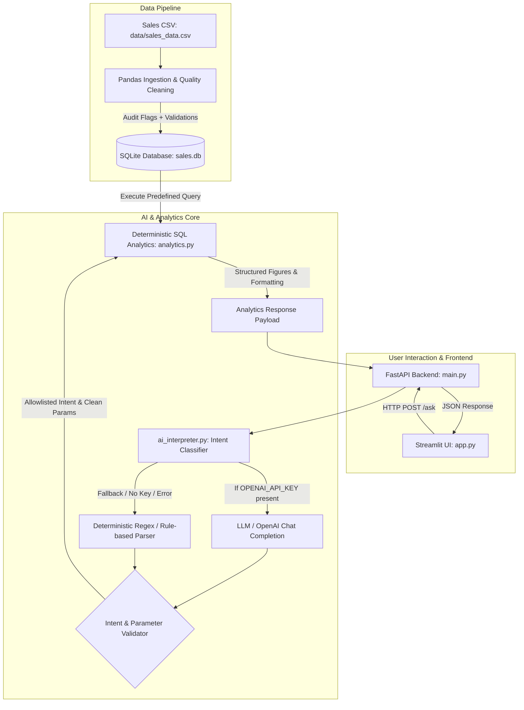

# Mini AI Business Intelligence Assistant — Architecture

## System Diagram

## Architectural Design Principles

### 1. Zero-Trust AI Calculation (Deterministic Computing)
- **The Core Problem**: LLMs are prone to hallucinating arithmetic, generating erroneous aggregations, or constructing invalid/dangerous SQL queries when given raw database execution access.
- **The Solution**: The LLM is strictly confined to **intent classification and slot extraction** (e.g., mapping `"How did January compare to February?"` to `intent="month_comparison", month1="2026-01", month2="2026-02"`).
- **Enforcement**: All calculations are executed via predefined, parameterized, read-only SQL queries run directly in SQLite. The LLM never touches the database, never generates SQL, and never outputs numeric financial values directly.

### 2. Transparent Fallback Mechanism
- If `OPENAI_API_KEY` is missing, invalid, or reaches a rate limit/network timeout, the application transparently and automatically falls back to an internal deterministic pattern matcher without failing or returning an unhandled exception.
- The user is always informed of the exact method used (`"LLM intent extraction"` vs `"rule-based fallback"`).

### 3. Data Integrity & Auditability
- During CSV ingestion, records are not silently dropped. Invalid quantities (e.g. `<= 0`) and missing unit prices are recorded in SQLite with `is_revenue_valid = 0` and descriptive `data_quality_note` strings.
- Revenue calculations strictly filter for valid, completed orders (`is_revenue_valid = 1 AND status = 'Completed'`), guaranteeing auditable, conservative financial metrics.

### 4. Separation of Concerns
- **`db.py`**: SQLite database setup, CSV normalization, quality validation, and connection management.
- **`analytics.py`**: Query definitions, mathematical logic, business rules, and deterministic natural-language answer formatting.
- **`ai_interpreter.py`**: LLM prompting, structured JSON schema enforcement, parameter validation, and fallback triggering.
- **`main.py`**: FastAPI REST API service with Pydantic validation, CORS middleware, and `/health` & `/ask` endpoints.
- **`app.py`**: Interactive Streamlit dashboard with KPI metric cards, dynamic Plotly visualisations, sample queries, and connection status monitoring.

